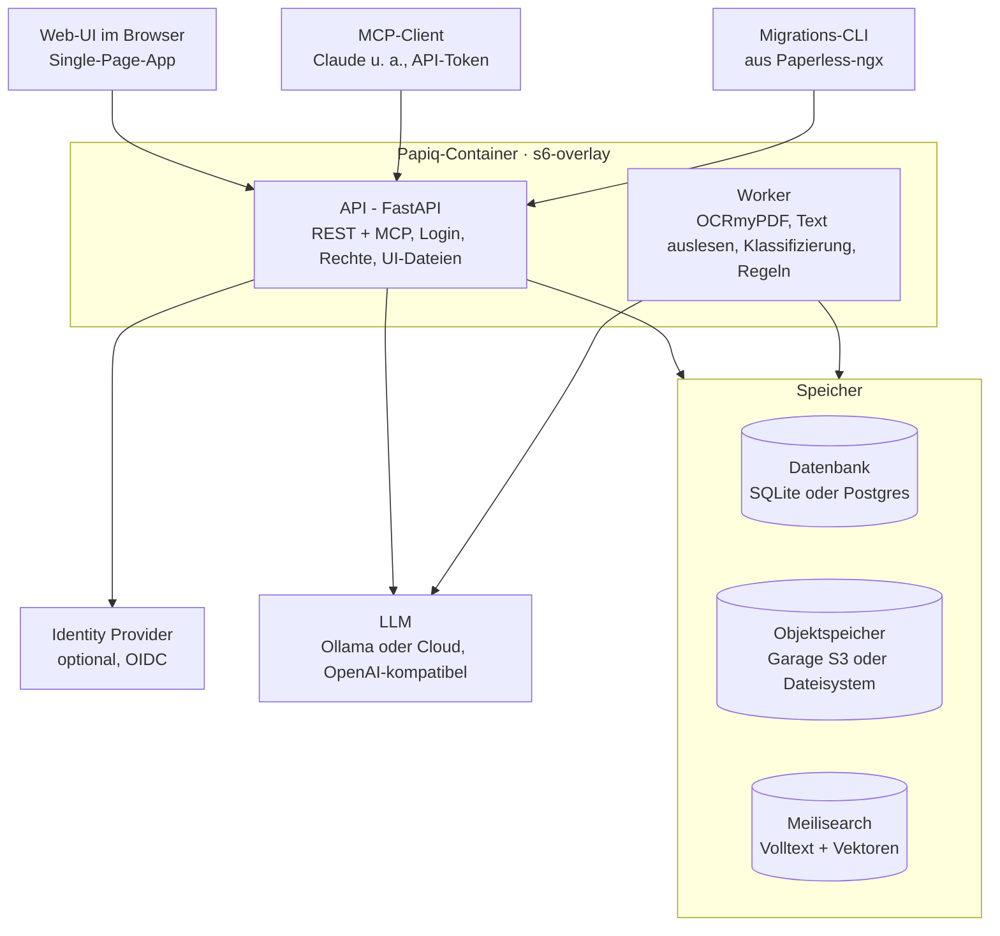

# Papiq – Architektur

Stand: 06.10.2026 · Tobias

## Ziel und Rahmen

Papiq ist ein selbst gehostetes, headless Dokumentenmanagementsystem als Ersatz für Paperless-ngx – Open Source, kostenlos, als Docker-Stack.

- Multi-User mit nativen Logins, keine Mandanten
- Headless: alle Funktionen nur über die API; Web-UI, MCP und Migrations-CLI sind Clients
- LLM lokal und in der Cloud nutzbar
- Erster Wurf mit 100 Dokumenten; Migration aus Paperless-ngx folgt als eigener Client

**Name:** Papiq, Eigenschreibweise **p:api:q** (Logo, Oberfläche). Technischer Name für Repository, Pakete, Images und Hostnamen: `papiq`.

**Logo-Konzept:** Wortmarke p:a~~p~~i:q mit grafisch durchgestrichenem mittlerem p. Ein Wort, vier Lesarten: **PAP**(er), p**API**q, pa~~p~~**I** (AI), pap**IQ**; das durchgestrichene p verweist zugleich auf „paperless“. Das Durchstreichen gibt es nur im Logo, nicht im Fließtext.

## Gesamtarchitektur

Papiq läuft als ein Docker-Container (API, Worker, Auslieferung der Web-UI, überwacht von s6-overlay) neben drei Speichern; LLM und Identity Provider sind extern.



Web-UI, MCP-Client und Migrations-CLI greifen ausschließlich über die API zu. Der Worker verarbeitet Dokumente als Jobs im Hintergrund und nutzt dieselben Speicher. API und Worker laufen als überwachte Dienste im selben Container (siehe Betrieb).

## Architekturprinzip: Ports und Adapter

Papiq ist hexagonal aufgebaut: Der fachliche Kern kennt keine Datenbank, kein S3, keinen Suchdienst und kein LLM – nur Schnittstellen (Ports), die er selbst definiert. Jede Technik steckt in einem austauschbaren Adapter.

- **Kern:** Dokumente, Spaces, Rechte, Regeln, Lanes, Pipeline-Ablauf. Reines Python, keine Framework-Abhängigkeiten.
- **Ports:** Python-Protocols, vom Kern definiert.
- **Adapter:** implementieren die Ports; welcher Adapter läuft, entscheidet die Konfiguration an einer zentralen Stelle beim Start.
- **Tests:** Jeder Port hat In-Memory-Adapter für Kern-Tests und eine Vertragstest-Suite, die jeder echte Adapter bestehen muss.

**Eingehende Adapter (rufen den Kern auf):** REST-API (FastAPI), MCP-Server, Worker (führt Jobs aus), Evaluation (Bewertungssatz durch Klassifizierung und Suche: `evaluate`, `evaluate-search`), Migrations-CLI.

**Ausgehende Ports (der Kern ruft auf):**

| Port | Adapter im ersten Wurf | Austauschbar gegen (Beispiele) |
| --- | --- | --- |
| Repository (Metadaten) | SQLAlchemy: SQLite, Postgres | andere Datenbank |
| Objektspeicher | S3 (Garage), lokales Dateisystem – gleichwertig, per Konfiguration | anderer S3-Server (z. B. SeaweedFS) |
| Suchindex | Meilisearch | Typesense, Postgres-Volltext |
| LLM | OpenAI-kompatible API | Anbieter-spezifische API |
| Embeddings | OpenAI-kompatible API | lokales Modell |
| Klassifikator | scikit-learn (TF-IDF, logistische Regression), Modell als `npz` | anderes Verfahren |
| OCR | OCRmyPDF mit Tesseract; auf Wunsch einer Person ein VLM als Texterkennung (OpenAI-kompatibel, als Plugin von OCRmyPDF) | entfernter OCR-Dienst |
| Parser | PDFium: der Text der Textebene, wie er gesetzt ist (Layout-Text) | anderer Parser |
| Job-Queue | Job-Tabelle in der Datenbank | Valkey/Redis-basierte Queue |
| Event-Bus | Outbox-Tabelle in der Datenbank, Verteilung im Prozess | Valkey Streams, NATS |
| Identität | nativer Login, OIDC | weitere Anbieter |
| Vorschau | PDFium (erste Seite als WebP) | anderer Renderer |
| Fundstellen (Zitat → Seite und Box) | PDFium (Textebene des Archiv-PDFs) | anderer Locator |
| Codes (Bar- und QR-Codes der Seiten) | zxing-cpp auf den Seiten des Archivs, mit PDFium in 300 dpi gerendert | anderer Leser |
| Datei-Metadaten (Tab „Metadaten“) | pikepdf (PDF-Infos, XMP, PDF/A), Pillow (Bilder, EXIF) | anderer Leser |
| Mustersuche (Regeln) | `regex` mit Zeitlimit | eigener Dienst |
| Templates (Regeln, Titelmuster) | Liquid (`python-liquid`), mit Grenzen für Schleifen und Ausgabe | andere Template-Sprache |
| Webhook-Versand | httpx2 | andere HTTP-Bibliothek |
| Uhr | Systemuhr | feste Uhr in Tests |
| Passwort-Hash, Geheimnis-Verschlüsselung, TOTP | Argon2id, AES-GCM, pyotp | andere Verfahren |

Webhook-Versand ist ein ausgehender Adapter, der Ereignisse vom Event-Bus abonniert. Jeder Port
hat einen In-Memory-Adapter für die Kern-Tests. Ausnahmen: die Mustersuche und die Templates. Der
Vertrag der Mustersuche verlangt eine Suche, die ein Zeitlimit abbricht und den Event-Loop nicht
blockiert; das kann die `regex`-Engine, Pythons `re` nicht. Der `regex`-Adapter braucht keinen
Dienst und läuft auch im Speicher-Container (Tobi, 12.10.2026). Ebenso der `liquid`-Adapter der
Templates: Ein Nachbau der Sprache im Speicher wäre ein zweiter Interpreter (Tobi, 14.10.2026).

Hexagonal betrifft den inneren Aufbau, nicht die Zahl der Container: Ein Adapter kann lokal laufen oder einen entfernten Dienst ansprechen, ohne dass sich der Kern ändert.

## Technologie-Stack

Backend und Worker in Python; ein Container mit s6-overlay als Prozessüberwachung.

| Bereich | Wahl | Status |
| --- | --- | --- |
| API | FastAPI, Pydantic | entschieden |
| Nebenläufigkeit | durchgängig async (FastAPI, SQLAlchemy async mit asyncpg bzw. aiosqlite) | entschieden |
| Ereignisse | Transactional Outbox in der Datenbank; kein Broker zum Start | entschieden |
| Datenzugriff | SQLAlchemy 2, Alembic | entschieden |
| Datenbank | SQLite oder Postgres, per Konfiguration | entschieden |
| Objektspeicher | Garage (S3) oder lokales Dateisystem, per Konfiguration | entschieden |
| Suche | Meilisearch Community Edition (MIT) | entschieden |
| OCR | OCRmyPDF | entschieden |
| VLM (Seiten lesen) | OpenAI-kompatible Schnittstelle mit Bildern, als Texterkennung in OCRmyPDF; nur auf Wunsch einer Person (Tobi, 15.10.2026); gemessen mit Claude Sonnet 5.5 über Open WebUI | entschieden |
| Parsing | Layout-Text aus der Textebene mit PDFium (statt Docling, Tobi 14.10.2026, siehe Ingest-Workflow) | entschieden |
| Datei-Metadaten | `pikepdf` (MPL-2.0), über OCRmyPDF ohnehin im Image, jetzt direkte Abhängigkeit (Tobi, 16.10.2026) | entschieden |
| Codes | `zxing-cpp` 3.1 (Apache-2.0; Pakete für amd64 und arm64, keine Systempakete): QR, Data Matrix, Aztec, PDF417, Code 128/39, EAN, ITF. Verworfen: `pyzbar` (Systempaket `libzbar0`, kein Data Matrix, zuletzt 2022), `pylibdmtx` (nur Data Matrix), OpenCV (groß, kein Data Matrix), `pyzxing` (Java) (Tobi, 15.10.2026) | entschieden |
| LLM | OpenAI-kompatible Schnittstelle (Ollama, Cloud) | entschieden |
| Klassifikator | scikit-learn, Vorhersage mit numpy | entschieden |
| Templates | Liquid (`python-liquid` 2.3, mit Babel): Regeln schreiben auch Nutzer, Liquid ist für Templates von Endnutzern gebaut (nur übergebene Daten, Grenzen für Schleifen und Ausgabe), die Syntax gleicht Jinja (Tobi, 14.10.2026; Jinja2 verworfen: Ausbrüche aus der Sandbox 2024/2025, keine Schleifengrenze) | entschieden |
| LLM-Modell (lokal) | `qwen3:8b` über Ollama mit 8192 Token Kontext (NUC, nur CPU); Bewertung siehe unten | entschieden |
| Embedding-Modell (lokal) | `snowflake-arctic-embed2` über Ollama, Anfragen mit dem Präfix `query: `; Bewertung unter „Suche“ | entschieden |
| Jobs | eigene Job-Tabelle über SQLAlchemy | entschieden |
| Authentifizierung | Argon2id, TOTP, Authlib (OIDC) | entschieden |
| Web-UI | SvelteKit (Svelte 5), Tailwind, shadcn-svelte; Ziel: cleanes, modernes Interface | entschieden |
| Template-Editor | CodeMirror 6 (`state`, `view`, `autocomplete`, `commands`) mit eigener Liquid-Färbung, nachgeladen nur wo ein Template steht; `lang-liquid` verworfen, es zöge HTML, CSS und JavaScript mit (Tobi, 15.10.2026) | entschieden |
| Container | ein Papiq-Image, Prozessüberwachung mit s6-overlay | entschieden |

Nicht verwendet: MySQL (gestrichen), LangGraph (kein Bedarf, siehe Ingest-Workflow), Procrastinate (nur Postgres).

## Datenhaltung

Drei Speicher mit klarer Aufgabe: Datenbank für Metadaten, Objektspeicher für Dateien, Meilisearch für die Suche.

**Datenbank (SQLite oder Postgres)**

- Enthält Metadaten, Stammdaten, Regeln, Jobs und Verarbeitungsprotokoll.
- SQLite nur auf lokalem Volume im WAL-Modus, nie auf Netzlaufwerk oder S3.
- Tests in CI gegen beide Datenbanken.

**Objektspeicher (S3 oder Dateisystem)**

- Zwei gleichwertige Adapter: S3 (erster Server: Garage) oder lokales Dateisystem.
- Papiq nutzt keine Speicher-Events. Ereignisse entstehen ausschließlich in der Outbox; so bleibt der Adapter frei tauschbar (Garage und Dateisystem kennen keine Events).
- Originale unveränderlich, Objekt-Key = SHA-256 des Inhalts; Dubletten werden darüber erkannt. Eine Datei, die derselbe Besitzer schon hat, wird abgelehnt; ein anderer Nutzer bekommt ein eigenes Dokument zum selben Objekt.
- Daneben die Derivate: Archiv-PDF mit Textlayer, der ausgelesene Text (`content.txt`, Klartext wie gesetzt) mit seiner Struktur (`content.json`: Seiten, Zeilen und Wörter mit Boxen), die Codes der Seiten (`codes.json`), Seitenbilder und Vorschau, die Anfragen an das Sprachmodell; dazu die Modelle des Klassifikators (`classifier/model-<n>.npz`) und die Logos der Kontakte (`contacts/<id>/logo.webp`).

**Suche (Meilisearch)**

- Hybride Suche: Volltext und Vektoren in einem Aufruf.
- Index ist abgeleitet und jederzeit aus Datenbank und S3 neu aufbaubar; Aktualisierung per Job, daher kurz verzögert.
- Nur API und Worker sprechen mit Meilisearch: der Worker schreibt den Index (Jobs, Abgleich, Neuaufbau), die API sucht; jede Suche wird auf die Reichweite des Nutzers gefiltert (Admins mit `all_users`: alle Dokumente).
- Deutsche Komposita werden zerlegt; Stemming nach Kenntnisstand nicht vorhanden, die semantische Suche fängt das ab ([Quelle](https://www.meilisearch.com/docs/resources/internals/typo_tolerance.md)).

## Datenmodell

Angelehnt an Paperless-ngx, ohne Speicherpfade, mit Spaces als Ablage- und Rechte-Einheit (bis 0.2: Schubladen; Tobi, 16.10.2026: „Space“ auf Deutsch und Englisch, wie die Unterkonten bei N26).

| Begriff | Bedeutung | Regeln |
| --- | --- | --- |
| Dokument | Datei mit Metadaten | Besitzer, genau ein Space, höchstens ein Kontakt, höchstens ein Typ, höchstens ein Thema (eines, das sein Kontakt führt), Hash, Dokumentdatum |
| Kontakt | Gegenseite des Dokuments (Paperless: Korrespondent) | höchstens einer pro Dokument (leer, bis das Urteil oder eine Person einen setzt); global, ohne Besitzer; Aliase und Kennungen (IBAN, USt-IdNr, Kundennummer, Personalnummer, E-Mail-Domain); beliebig viele Kontaktgruppen; die Themen, die er führt; ein Logo |
| Dokumenttyp | Art des Dokuments | global; bringt zugeordnete Felder mit, je Pflicht oder optional; optional ein Titelmuster; beliebig viele Typgruppen; ein Icon |
| Tag | Merkmal mit einer Art (`scope`) | global; Arten `document` (am Dokument, beliebig viele), `contact` (Kontaktgruppe), `document_type` (Typgruppe), `topic` (Thema); verschachtelbar; Icon und Farbe; trägt keine Rechte |
| Thema | worum es mit einem Kontakt geht (Arbeit, Krankenversicherung, Girokonto) | ein Tag der Art `topic`: globaler Katalog, am Kontakt freigeschaltet; höchstens eines pro Dokument |
| Feld | frei definierbares Feld (Paperless: Custom Field) | Geltungsbereich global oder je Dokumenttyp; fester Datentyp; Pflicht oder optional (je Typ, ein globales mit eigenem Schalter); optional eine Beschreibung, was hineingehört (für das Modell); „nur von Hand“: das Modell wird nie danach gefragt |
| Space | Ablage- und Rechte-Einheit (bis 0.2: Schublade) | hat einen Besitzer; teilbar; jeder Nutzer hat einen privaten Standard-Space (nicht teilbar, nicht löschbar) |

- Stammdaten (Kontakte, Typen, Tags aller Arten, Felder) pflegen nur Admins. Ausnahme: Wählt eine Person in der Prüfansicht einen Kontakt für ein offenes Kontaktfeld, lernt der Kontakt den vom Modell gelesenen Namen als Alias, gleich welche Rolle sie hat (Tobi, 10.10.2026).
- Felddatentypen: Text, Zahl, Betrag (Dezimalzahl mit ISO-4217-Währung je Wert), Datum, Ja/Nein, Auswahl (eine Option aus fester Liste), Link (absolute http(s)-URL), Zeitraum (Anfang und Ende, beide Tage eingeschlossen; ob Tag, Kalenderwoche, Monat, Quartal, Jahr oder frei, folgt aus den Enden).

**Tags, Gruppen und Themen** (Tobi, 16.10.2026)

- Jedes Merkmal eines Dokuments ist entweder ein Klassifizierungsmerkmal, das Papiq selbst ermittelt, oder eines, das nur ein Mensch festlegen kann. Dafür hat jeder Tag (wie jedes Feld, siehe Felder) einen Schalter: `auto` (die Signale schlagen vor und setzen) oder `manual` (nur Personen und Regeln setzen ihn, etwa Status-Tags wie „zu bezahlen“, „Wiedervorlage“). Kontakt- und Typgruppen sind immer `manual`.
- Arten (`scope`): `document` – Merkmal am Dokument, wie bis 0.2; `contact` – Kontaktgruppe („Versicherung“, „Arbeitgeber“), ein Kontakt in beliebig vielen; `document_type` – Typgruppe („Rechnung“ über „Arztrechnung“ und „Handwerkerrechnung“), ein Typ in beliebig vielen; `topic` – Thema. Namen sind je Art eindeutig: „Versicherung“ darf Kontaktgruppe und Thema zugleich sein.
- Die Gruppe sagt, wer schreibt; das Thema, worum es geht. Der Lohnzettel der Versicherung, bei der man arbeitet, liegt in der Kontaktgruppe „Versicherung“ und im Thema „Arbeit“.
- Hierarchie: Ein Tag hat höchstens einen Elterntag derselben Art; keine Zyklen, höchstens fünf Ebenen. Gespeichert wird nur der gesetzte Tag, seine Vorfahren sind abgeleitet: Das Dokument findet sich über den Tag und alle Vorfahren, Filter und Regelbedingungen treffen die Nachfahren mit. Setzt man Kind und Elternteil, bleibt das Kind; ein Elterntag darf auch allein gesetzt werden. Bekommt ein Tag oder eine Gruppe einen anderen Elterntag, behalten Dokumente (bei Gruppen Kontakte und Typen), die danach einen Tag und einen seiner Vorfahren tragen, nur den Nachfahren, als wären sie neu gesetzt: ein Job über die betroffenen Zeilen, der weder Bestätigung noch Lane ändert und die Sucheinträge erneuert (Tobi, 17.10.2026). Ein Tag mit Kindern oder in Gebrauch lässt sich nicht löschen.
- Ein Dokument erbt die Kontaktgruppen seines Kontakts und die Typgruppen seines Typs mit ihren Vorfahren (abgeleitet, nicht gespeichert); am Dokument lassen sie sich nicht entfernen.
- Themen: ein globaler Katalog; ein Admin schaltet sie am Kontakt frei, im Kontaktdialog oder indem er am Dokument ein Thema wählt, das der Kontakt noch nicht führt. Ein Dokument trägt höchstens ein Thema, eines, das sein Kontakt führt; wechselt der Kontakt, bleibt es nur, wenn der neue es auch führt. Die Freischaltung lässt sich nicht entfernen, solange Dokumente des Kontakts das Thema tragen. Kennungen eines Kontakts können auf eines seiner Themen zeigen (siehe Kontakte).
- Anzeige: je Tag „am Dokument zeigen“, die Vorgabe folgt der Art (Gruppen aus, Themen und Dokument-Tags an). Ausgeblendete Tags sehen Filter, Suche, Regeln und Templates weiter. Am Dokument steht nur das Blatt; den Pfad („Versicherung › Krankenversicherung“) zeigen Tooltip und Auswahlfeld, am Handy ein Tippen. Die Gruppen stehen, wenn eingeblendet, beim Kontakt und beim Typ.
- Aussehen: Tags und Typen tragen ein Icon aus Lucide (eine Auswahl von 170 nach Lebensbereichen, die übrigen über die Suche, alles aus dem eigenen Build), Tags eine Farbe: zwölf Hauptfarben, je für hell und dunkel abgestimmt, oder hinter „Mehr Farben“ eine eigene als `#rrggbb`; die Schrift des Chips folgt dem Kontrast. Kontakte zeigen ihr Logo, sonst ihre Initialen.
- Personen (wen ein Dokument betrifft) sind keine Tags; sie sollen Nutzer werden (später).

## Berechtigungen

Rechte hängen am Space, nie am einzelnen Dokument. Ein Umbau der Rechte folgt in einem späteren Release (Tobi, 16.10.2026).

- **Rollen:** Admin und Nutzer. Admins haben alle Rechte und sehen alles (Tobi, 08.10.2026): Sie lesen und ändern alle Dokumente (auch fremde in Gelb, Rot und in Verarbeitung), lesen das Verarbeitungsprotokoll, wiederholen, verarbeiten neu, bestätigen und löschen; sie sehen und verwalten alle Spaces (umbenennen, Freigaben, löschen) und legen in jeden ab; sie lesen und ändern alle Regeln und Webhooks; dazu Nutzer und Stammdaten. Ein deaktivierter Admin hat keine Rechte.
- **Reichweite:** eigene Dokumente und grüne Dokumente in eigenen oder freigegebenen Spaces. Listen, Posteingang und Suche zeigen die Reichweite; Admins schalten auf alle Nutzer um (`all_users`), in der Web-UI über „Alle Nutzer einbeziehen“ im Benutzermenü, im Browser gemerkt und am Avatar angezeigt; es gilt für Dokumente, Suche, Posteingang mit seiner Zahl, Regeln und die Zahlen an den Stammdaten (Tobi, 16.10.2026). Webhooks melden nur Dokumente in der Reichweite ihres Besitzers, auch bei Admins; SSE erhalten Admins zu allen Dokumenten.
- **Besitzer** eines Dokuments hat Lese- und Schreibrecht.
- **Andere Nutzer** sehen ein Dokument nur über einen Space, der mit ihnen geteilt ist – mit „lesen“ oder „lesen/schreiben“.
- **Teilen nach Kontakt und Typ** wird als Ablageregel umgesetzt: „Kontakt X + Typ Y → Space Z“. Sichtbarkeit bleibt eine explizite Zuordnung und ändert sich nicht still durch eine Fehlklassifizierung.
- **Posteingang:** Dokumente in Gelb oder Rot sieht nur der Besitzer (und Admins), bis sie gelöst sind. Bestätigt ein Admin, legt er in jeden Space ab; die Ablage prüft sonst, ob der Besitzer in den Space schreiben darf.
- **Verschieben** in einen anderen Space: der Besitzer (nur in Spaces, in die er schreiben darf) oder ein Admin (jedes Dokument in jeden Space). Eine Freigabe erlaubt kein Verschieben.
- **Stammdaten** sind global sichtbar – Kontaktnamen sehen alle Nutzer (bewusst akzeptiert).

## Authentifizierung

Native Logins sind der Standard; ein externer Identity Provider ist optional.

| Zugang | Verfahren |
| --- | --- |
| Web-UI | Benutzername + Passwort (Argon2id), 2FA per TOTP optional pro Nutzer; Session-Cookie (HTTP-only) |
| Web-UI mit IdP | OIDC-Login (Authlib), verknüpft mit dem lokalen Konto |
| CLI, lokaler MCP-Client | persönliche API-Tokens mit Stufen: lesen / lesen + schreiben |
| MCP von außen (später) | OAuth: die API gibt Tokens aus; Transport (HTTP, Bearer-Token) und Prüfung bleiben gleich |

## Ingest-Workflow

Stand 0.2 (M14 Graph, M15 Verstehen; Zielbild und Entscheidungen in `ingest-v2.md`). Seitenbilder liest ein VLM nur auf Wunsch einer Person (Issue #53); die Eskalation (M18) fehlt noch.

Die Verarbeitung ist ein Graph aus Knoten; jeder Knoten ist ein Job mit Wiederholung, Knoten ohne gegenseitige Abhängigkeit laufen parallel, und das Ergebnis landet in einer von drei Lanes.

```
receive ─┬─► pages ───────────────────────────────────────────────┐
         └─► ocr ─► parse ─┬─► signal_llm ────────┐                 │
                           ├─► signal_classifier ─┤                 │
                           ├─► signal_neighbours ─┼─► judge ─► fields ─► apply_rules ─► file
                           └─► signal_facts ──────┘
```

**Drei Ebenen**

1. Technische Pipeline, fest im Code: Empfangen (Hash, Dublette, Objektspeicher) → OCR und Seitenbilder → Parsen.
   - OCR: Seiten mit eigenem Text bleiben, wie sie sind (`--skip-text`). Eine unsichtbare Textschicht ist aber die einer anderen OCR (Scanner, älteres Archiv wie ecoDMS), womöglich schlecht und ohne Angabe, wie gut sie las: Ein solches PDF liest OCRmyPDF selbst neu (`--redo-ocr`, sichtbarer Text bleibt, ohne `--deskew`, das OCRmyPDF dabei nicht erlaubt; Tobi, 14.10.2026). Ist der Text eines PDFs nicht lesbar (mindestens 30 % der Zeichen einer Seite stehen für nichts: eine Schrift ohne Zeichentabelle, wie sie der PDF-Drucker von ecoDMS schreibt, liefert Steuerzeichen), erkennt OCRmyPDF jede Seite aus ihrem Bild (`--force-ocr`); das Archiv trägt die Seiten dann als Bilder, das Protokoll nennt den Grund (Tobi, 15.10.2026).
   - VLM als Texterkennung (Tobi, 15.10.2026): Ein Dokument an ein VLM zu senden, ist immer die Entscheidung eines Menschen. Besitzer und Admins haben den Knopf „Mit VLM lesen“, sobald `PAPIQ_VLM_*` eingerichtet ist; empfohlen ist er, wo die Texterkennung das Dokument rot (kein Text) oder gelb (eine schwach gelesene Seite) macht, eine eigene Schwelle gibt es nicht. Dann wird das ganze Dokument ab OCR neu verarbeitet: OCRmyPDF erkennt jede Seite aus ihrem Bild (`--force-ocr`), Drehung und Schräglage bestimmt weiter Tesseract, den Text liest das VLM als Texterkennung (ein Plugin von OCRmyPDF): jede Zeile mit ihrer Box in Pixeln des gesendeten Bildes, höchstens 1,15 Megapixel (Boxen in Tausendsteln liefen im Versuch weg). Der Text zählt als OCR und steht in der Textebene des Archivs; Prüfungen wie sonst, was das VLM als unleserlich markiert, zählt als unsicheres Wort. Das Archiv ist der Speicher (seine Metadaten nennen das VLM als Texterkennung): Neu verarbeiten ab Parse und `reparse` behalten die Lesung. Neu verarbeiten ab OCR fragt bei einem Dokument, das zuletzt das VLM las, ob es wieder liest, vorausgewählt; abgewählt liest Tesseract, und die Lesung geht verloren (Tobi, 15.10.2026). Der Dialog nennt Endpunkt und Modell, bevor Seiten hinausgehen; das Protokoll nennt Modell, Prompt und Tokens, die Aufrufe liegen wie die des Sprachmodells beim Dokument. Kein MCP-Werkzeug.
2. Verstehen: vier Signale schlagen vor, das Urteil entscheidet Kontakt, Typ, Tags und Datum, der Felder-Knoten liest die Felder des entschiedenen Typs und den Titel, dann die Regeln.
3. Mensch im Ablauf: Posteingang für alles, was nicht grün ist.

**Parsen: der Text, wie er gesetzt ist (Tobi, 14.10.2026; statt Docling).** Der Parse-Knoten liest die Textebene des Archiv-PDFs mit PDFium: jede Zeile so, wie sie gedruckt ist, ihre Wörter in Spalten auf dem Raster der Seite, sodass eine Beschriftung bei ihrem Betrag bleibt und Zahlenspalten untereinander stehen. Ausdrucke in Festbreitenschrift behalten ihre Spalten genau; eine Seite, deren Text quer läuft, wird in dieser Richtung gelesen; Kopf- und Fußzeilen bleiben im Text. Wörter enden an den Lücken zwischen den Zeichen, nicht an Leerzeichen (manche PDFs setzen keine). Ergebnis ist Klartext (`content.txt`, Seiten durch einen Seitenvorschub getrennt) und eine eigene Struktur (`content.json`: Seiten, Zeilen, Wörter mit Boxen). Ein Lauf von Leerzeichen zählt im Eingabebudget des Modells einmal.

Begründung (Vergleich in `ocr_test`, vier echte und fünf synthetische Dokumente mit bekanntem Text): Docling ließ Kopf- und Fußzeilen weg (in einer Stichprobe von 250 Dokumenten standen bei 89 Kennungen nur dort), legte die Zeilen von Formularen in Zellen zusammen (die Lohnabrechnung: Brutto falsch, Zitat nicht im Text), polsterte Tabellen so, dass das Budget den Text abschnitt, und brauchte bis zu einer Minute und 2 GB je Dokument. Der Layout-Text verlor nichts gegenüber der Textebene, hielt Beträge bei ihren Beschriftungen und braucht Millisekunden. MarkItDown verklebte die Wörter eines Briefs ganz; Docling mit eigener OCR las schlechter als OCRmyPDF. Schlechte Scans und Fotos kann keine dieser Varianten retten, weil sie von der OCR abhängen; dort las nur ein VLM (Issue #53).

Bestand: Ein Dokument von vor 0.2 behält Doclings Markdown (`content.md`, wird solange gelesen), bis `reparse` (Befehl, `POST /pipeline/reparse`, Admins) seinen Text neu ausliest; Knoten, Lane und Metadaten bleiben, der Suchindex bettet neu ein, danach wird der Klassifikator neu trainiert.

**Zustand und Protokoll**

- Jeder Knoten hat einen Zustand (wartet, läuft, fertig, übersprungen) und ein Ergebnis: *ok*, *unsicher (mit Grund)* oder *fehlgeschlagen*.
- Protokoll je Knoten: Eingabe, Ergebnis, Konfidenz, Grund, Modell- und Pipeline-Version, Dauer; die Signale schreiben ihre Vorschläge, Urteil und Felder je Feld eine Prüfung mit gereihten Kandidaten und ihren Quellen. Jede Quelle trägt ihren gemessenen Wert und die Schwelle, ab der sie einen Wert nennt (Klassifikator: Wahrscheinlichkeit; Sprachmodell: wie genau der gelesene Name zum Kontakt passt, denn das Modell gibt keine Wahrscheinlichkeit; Nachbarn: Stimmen und höchste Ähnlichkeit). Die Konfidenz eines Felds ist nur die Zusammenfassung der Regel (1, bei Unsicherheit höchstens 0,89); die Oberfläche zeigt statt ihrer die Werte der Quellen (Tobi, 14.10.2026).
- In der UI: der Graph live mit Zustand und Dauer, jedes Zwischenergebnis, sobald es vorliegt; „ab Knoten X neu“ setzt X und alle Nachfolger zurück; ab `judge` laufen auch die Signale ohne Modellaufruf neu (Fakten, Klassifikator, Nachbarn), damit ein neuer Alias, eine neue Kennung oder ein neues Modell wirkt; die Antwort des Sprachmodells bleibt.

**Lanes**

| Lane | Bedeutung | Auslöser |
| --- | --- | --- |
| Grün | sauber durchgelaufen | alle Knoten ok, alle Prüfungen bestanden |
| Gelb | Mensch muss bestätigen | ein Wert nicht sicher genug, Widerspruch zwischen Signalen, neue Gegebenheit |
| Rot | Mensch muss eingreifen | technischer Fehler nach allen Wiederholungen, oder das Modell antwortete und nichts wurde erkannt |

Die Lane eines Dokuments ist das schlechteste Ergebnis aller Knoten. Solange die Verarbeitung läuft, hat ein Dokument keine Lane; andere Nutzer sehen es erst, wenn es grün ist. Gelbe und rote Dokumente bleiben im Posteingang des Besitzers, bis sie gelöst sind.

**Signale**

Signale bestimmen die Lane nicht: Sie enden ok, auch wenn sie sich enthalten (der Grund steht in der Ausgabe); fehlschlagen kann nur `signal_llm`, nach zwei unpassenden Antworten.

| Signal | Vorschlag |
| --- | --- |
| `signal_llm` | Ein Aufruf des Sprachmodells (Prompt `propose-3`): Absender und Empfänger, Typ, Tags (die automatischen der Art `document`), das Thema (unter den Themen der vorausgewählten Kontakte), Datum, Titel, Sprache, dazu die Felder des gewählten Typs und die globalen, je mit Zitat. Der Absender wird Kontakt, der Empfänger nie. Ohne Modell enthält es sich. |
| `signal_classifier` | Klassifikator aus TF-IDF (Wörter und Wortpaare, keine reinen Ziffern) und logistischer Regression je Ziel: Kontakt, Typ, Thema, je automatischem Tag. Ein Modell für alle Nutzer. Ohne trainiertes Modell enthält es sich. |
| `signal_neighbours` | Die fünf ähnlichsten bestätigten Dokumente, die der Besitzer lesen darf (Vektor des ersten Abschnitts gegen den Suchindex); ihr Kontakt, Typ, Thema und ihre Tags aus der Datenbank, dazu was die bestätigten Dokumente überhaupt tragen. Ohne Embeddings oder Index enthält es sich. |
| `signal_facts` | Harte Beweise in Text und Codes: Name oder Alias eines Kontakts ganz im Text, Kennungen von Kontakten (eine Kennung mit Thema belegt auch das Thema), unbekannte IBANs und USt-IdNr als Hinweis. Es liest die Bar- und QR-Codes der Seiten des Archivs einmal (`codes.json`, die OCR löscht die Datei mit einem neuen Archiv): Eine Kennung aus einem Code zählt wie eine im Text, der Empfänger eines GiroCodes wie ein Name und schlägt allein nichts vor. Welche Kennungen das Dokument zeigt, hält es in `document_identifiers` fest (Tobi, 15.10.2026). |

Übernommene Dokumente (Migration) durchlaufen die Signale ohne Modellaufruf; das Urteil übernimmt die Metadaten aus Paperless.

**Urteil (Grün-Regel, Tobi 13.10.2026)**

Nicht hundertprozentig sicher heißt kein Grün. Ein Signal *nennt* einen Wert, wenn es sicher ist: das Modell, wenn sein Absender einem Kontakt (Name oder Alias, Rechtsform und Satzzeichen beiseite) zu mindestens 0,9 gleicht und kein anderer nahe kommt, bzw. einen Typ oder Tag aus der Liste; der Klassifikator mit seiner besten Klasse ab `PAPIQ_CLASSIFIER_THRESHOLD` (0,8); die Nachbarn mit mindestens zwei Stimmen und mehr als der Hälfte der gefundenen, einen Kontakt nur, wenn kein anderer Kontakt ebenfalls zwei Stimmen hat (Tobi, 14.10.2026: Nachbarn, die sich auf mehrere Absender verteilen, gleichen sich durch das Formular, bei Lohnabrechnungen durch den Angestellten, nicht durch den Absender; sie nennen dann keinen und widersprechen nicht).

- **Widerspruch** ist immer gelb, mit allen Kandidaten und ihren Quellen: ein Signal nennt einen anderen Wert (auch einen, den es nicht hätte nennen können), der Empfänger des Modells ist der Kontakt, die Kennung eines anderen Kontakts steht im Text, oder der Absender des Modells ist kein Kontakt und hat mit dem Kandidaten nichts zu tun.
- **Kontakt** grün ohne Widerspruch, wenn ein harter Beweis (Kennung, Name oder Alias im Text) vorliegt und ein Signal ihn nennt, oder wenn der Absender des Modells ihm zu mindestens 0,75 gleicht und Klassifikator oder Nachbarn ihn nennen. Eine Kennung allein ergibt einen gelben, gereihten Vorschlag; ein Name im Text schlägt allein nichts vor (Kontoauszüge nennen Zahlungsempfänger, Lohnnachweise den Angestellten).
- **Typ** grün ohne Widerspruch, wenn zwei Signale ihn nennen, oder wenn nur das Modell ihn nennt und kein anderes Signal ihn abdeckt (Kaltstart je Wert). Ein Signal deckt einen Wert ab, wenn es ihn hätte nennen können: der Klassifikator, wenn er auf ihn trainiert ist; die Nachbarn, wenn sie welche fanden und ein bestätigtes Dokument den Wert trägt.
- **Tags** (die automatischen der Art `document`) machen nie gelb: gesetzt, wenn zwei Signale sie nennen oder nur das Modell und kein anderes Signal sie abdeckt; sonst ein Vorschlag. Manuelle Tags schlägt kein Signal vor.
- **Thema** (Tobi, 16.10.2026) nach dem Kontakt und nur unter dessen Themen: gesetzt, wenn der Kontakt grün ist und eine Kennung des Paares aus Kontakt und Thema im Text steht und ein Signal das Thema nennt, oder wenn zwei Signale es nennen. Sonst ein Vorschlag; nennen Signale verschiedene Themen, bleibt es leer mit allen Kandidaten. Ein Thema macht nie gelb.
- **Datum**: Der Wert muss im Text stehen und plausibel sein.
- Ohne den Vorschlag des Modells ist das Urteil unsicher (eine Person klassifiziert); rot nur, wenn das Modell antwortete und kein Signal etwas erkannte.

**Felder (`fields`)**

- Gelesen werden die Felder des entschiedenen Typs und die globalen. Hat das Modell nach dem Typ gefragt, den das Urteil entschied, werden seine Werte übernommen; sonst (nach einer Korrektur des Typs) fragt der Knoten das Modell nach den fehlenden (Prompt `extract-4`).
- Nur von Hand (Tobi, 16.10.2026, Issue #52): Ein Feld „nur von Hand“ fragt Papiq nie beim Modell an, weder in `signal_llm` noch in `fields`; Personen und Regeln setzen es. Ist es für den Typ Pflicht, bleibt das Dokument gelb, bis eine Person es setzt (etwa die Archivnummer vom Papier).
- Ein Feld ist je Zuordnung zu einem Typ Pflicht oder optional, ein globales mit eigenem Schalter; nach der Übernahme ist alles optional (Tobi, 13.10.2026). Pflicht: der Wert muss gefunden und geprüft sein, sonst gelb. Optional: ohne Wert bleibt das Feld leer; ein Wert, der die Prüfung nicht besteht, macht gelb.
- Werte werden gelesen, wie Menschen sie schreiben (`2.111,68 €`, `12. März 2026`, `ja`); eine mehrdeutige Zahl so, wie der Text sie zeigt, sonst nach der Sprache des Dokuments. Der Wert muss im Text stehen; ein Datumsfeld gleich dem Dokumentdatum ist nur ein Vorschlag, weil Modelle das Dokumentdatum für fehlende Daten wie die Fälligkeit einsetzen.
- Beschreibung (Tobi, 14.10.2026): Feldnamen vergeben wir intern (`LA_Brutto`), so stehen sie auf keinem Dokument. Die Beschreibung eines Felds sagt dem Modell, was hineingehört (bis 300 Zeichen, in beiden Prompts hinter Name und Optionen; in der Feldverwaltung und im Formular unter dem Feld).
- Das Zitat muss wörtlich im Text stehen und den Wert zeigen. Der Prompt verlangt es Zeichen für Zeichen, Zahlen unverändert, ohne Wörter aus verschiedenen Stellen zu verbinden; stehen Beschriftung und Wert getrennt (Tabelle, Formular mit Kästen), die Zeile des Werts. Die Prüfung bleibt streng: Eine gelockerte (die Wörter des Zitats nahe beim Wert) hätte in der Devinstanz zehn von elf falschen Werten grün gemacht (Tobi, 14.10.2026).
- Ein Wert, der wörtlich dastehen kann (Betrag, Zahl, Datum, Text, Link; auch das Dokumentdatum), braucht ein Zitat, das ihn selbst zeigt; ein Betrag zählt dort nur als Betrag, mit Nachkommastellen oder Währung daneben (`620,00`, `620 €`, nicht eine nackte `620`). Sonst ist er nur ein Vorschlag. Anlass: Auf einem zerfallenen Scan zitierte das Modell nur die Beschriftung und machte aus einer einzelnen Zahl zehn Zeilen tiefer den Wert, und beides bestand die Prüfung (Tobi, 14.10.2026).
- Schwach gelesene Seiten (Tobi, 14.10.2026): Die OCR schreibt je Seite, die sie selbst liest, die Wörter und die unsicheren (unter 60 % Sicherheit von Tesseract, aus dem hOCR) ins Protokoll. Liest das VLM, zählen die Stellen, die es als unleserlich markiert, als unsichere Wörter. Ab `PAPIQ_POOR_READING_THRESHOLD` (Vorgabe 8 %) unsicheren Wörtern gilt eine Seite als schwach gelesen; ein Wert, dessen Zitat dort steht (ohne Fundstelle: auf irgendeiner gelesenen Seite), ist nur ein Vorschlag. Tesseract ist sich auch bei Fehllesungen sicher, darum zählt die Seite, nicht das Wort. Die Prüfung, ob die Beschriftung beim Wert steht, ist Issue #55.
- **Zeitraum** (Tobi, 15.10.2026): Den Bezug eines Dokuments auf einen Zeitraum, der nicht sein Datum ist (ein Zeitnachweis vom Oktober für den September, eine Lohnabrechnung „für September 2019“), trägt ein Feld vom Typ Zeitraum, kein eingebautes Feld: Der Admin legt etwa „Bezugszeitraum“ an und ordnet es den Typen zu, Pflicht oder optional je Typ, die Beschreibung sagt dem Modell, was gemeint ist. Das Modell gibt ihn als `{start, end}` (`extract-4`) oder wie geschrieben (`September 2026`, `KW 38/2026`, `Q3 2026`, `2025`, `01.09.–30.09.2026`, ein Datum als dieser Tag). Er wird geprüft wie ein Datum: lesbar, plausibel, das Zitat zeigt ihn, wie er dasteht oder mit erstem und letztem Tag. Ohne Jahr nimmt er das des Dokumentdatums und ist nur ein Vorschlag; ein einzelner Tag gleich dem Dokumentdatum ebenso. Die Feldregeln gelten sonst unverändert. Filter in Liste und Suche kommen später. Geschrieben wird ein Zeitraum in der Web-UI und in Templates nach ISO 8601, ein Quartal wie üblich als `2026-Q3` (ISO kennt dafür keine Kurzform): `2026`, `2026-Q3`, `2026-09`, `2026-W38`, ein Tag als `2026-09-15`, sonst seine Enden `2026-09-01/2026-09-14` (Tobi, 16.10.2026). Das Feld „Zeitraum“ im Formular nimmt diese Formen und die deutschen an (`KW 38/2026`, `Q3 2026`, `09/2026`, `September 2026`, `15.09.2026`, eine Spanne aus zweien), setzt Von und Bis und zeigt geänderte Enden wieder an. Der Suchindex hält beide Schreibweisen. Einfache Datumsangaben bleiben, wie sie sind.
- **Titel**: der Titel des Modells, solange das Dokument noch den Dateinamen oder den Titel der Maschine trägt. Regeln setzen den Titel weiter und ersetzen den der Maschine ohne Gelb.
- **Titelmuster** (Tobi, 14.10.2026): Ein Titelmuster ist die Abkürzung für eine vorgefertigte Regel. Setzt ein Admin am Typ ein Muster, entsteht im selben Schritt eine globale Regel des Typs: „Dokumenttyp ist X → Titel setzen“, beim Eingang und bei Änderungen (`title_pattern_rules`, `RuleOut.managed_by_document_type_id`). Sie folgt dem Muster (neue Version bei jeder Änderung, gelöscht mit Muster oder Typ, Name = Name des Typs) und ist sonst schreibgeschützt (409); unter Regeln steht sie mit einem Link zum Typ, „auf bestehende Dokumente anwenden“ geht wie bei jeder Regel. Sie ist die einzige globale Regel, die den Titel setzt, und weicht einer anderen Regel, die ihn setzt (Notiz `yielded`, kein Konflikt); hat eine Person den Titel gesetzt, gilt `overruled`. Fehlt ein Wert, den das Muster schreibt, setzt sie nichts: Der Titel des Modells bleibt. Beim Bestätigen laufen die Regeln wieder und rendern das Muster mit den entschiedenen Werten.

**Kontakte: Aliase und Kennungen**

- Aliase (Tobi, 10.10.2026): weitere Namen eines Kontakts („Nord Krankenversicherung AG“ für „Nord Versicherungsgruppe“), über alle Kontakte eindeutig zusammen mit den Namen. Wählt die Person in der Prüfansicht einen bestehenden Kontakt, wird der gelesene Name dessen Alias, sofern er mit Name oder Alias ein Wort (ab drei Buchstaben) teilt oder so ähnlich ist wie ein Kontaktvorschlag; war er Alias eines anderen Kontakts, wandert er. Ein automatisch grüner Kontakt lernt keinen Alias. Aliase stehen auf einer Zeile (höchstens 100 je Kontakt, gelernte höchstens 100 Zeichen); die Listen im Prompt gelten wie der Text als Daten. Keine Aliase für Tags; Paperless-Match-Regeln werden nicht übernommen.
- Kennungen (IBAN mit Prüfziffer, USt-IdNr, Kundennummer und Personalnummer hinter einer Beschriftung, E-Mail-Domain ohne Freemail), eindeutig über alle Kontakte. Die Personalnummer (Tobi, 15.10.2026) belegt den Arbeitgeber, dessen Lohnabrechnungen und Zeitnachweise sie tragen: „Personalnummer“, „Personal-Nr.“, „Pers.-Nr.“, „Mitarbeiternummer“, „Employee ID“; 3 bis 30 Buchstaben und Ziffern, ohne führende Nullen verglichen („00012345“ = „12345“). Admins pflegen sie von Hand; das Training lernt weitere: eine Kennung, die in mindestens zwei bestätigten Dokumenten steht, alle eines Kontakts (die eigene IBAN steht bei vielen und wird nie gelernt). Eine verworfene gelernte Kennung bleibt gesperrt; eine gelernte kann von Hand übernommen werden.
- Anheften (Tobi, 15.10.2026): Eine Kennung ohne Kontakt, die ein Dokument zeigt (im Text oder in einem Code), heftet ein Admin in den Fakten des Dokuments an dessen Kontakt oder einen anderen (`POST /contacts/{id}/identifiers`, eine Kennung von Hand; 409, wenn ein anderer Kontakt sie von Hand trägt). Steht sie auch auf bestätigten Dokumenten anderer Kontakte, warnt die Zeile vorher: vermutlich das eigene Konto (`document_identifiers`, nur für Admins gezählt). Das Dokument wird danach nicht neu bewertet; die nächste Verarbeitung nutzt die Kennung.
- Kennungen und Themen (Tobi, 16.10.2026): Eine Kennung gehört weiter genau einem Kontakt und kann zusätzlich auf eines seiner Themen zeigen (Personalnummer → „Arbeit“, Versicherungsscheinnummer → „Krankenversicherung“); sie belegt dann Kontakt und Thema. Admins wählen das Thema je Kennung im Kontaktdialog und beim Anheften (vorbelegt mit dem Thema des Dokuments). Das Training gibt einer gelernten Kennung ein Thema nur, wenn alle ihre bestätigten Dokumente dasselbe Thema tragen; sonst bleibt sie ohne.
- Logo (Tobi, 16.10.2026): Ein Admin lädt es hoch (PNG, JPEG oder WebP bis 1 MB; kein SVG, es kann Skripte tragen); Papiq legt es auf 128 px als WebP im Objektspeicher ab. Mit `PAPIQ_LOGO_FETCH=true` (Vorgabe aus: Papiq fragt sonst nie ungefragt nach außen) holt der Worker es von der eigenen Website des Kontakts, sobald er eine Domain als Kennung hat, dazu auf Knopfdruck und für den Bestand mit `fetch-logos`: `apple-touch-icon`, Web-App-Manifest, `<link rel="icon">`, `/favicon.ico`, das größte Rasterbild ab 64 px. Ein hochgeladenes Logo hat Vorrang und wird nie überschrieben. Bekommt ein Kontakt mit abgerufenem Logo eine neue Domain (von Hand, gelernt, angeheftet), holt der Worker das Logo von dort neu; findet er keines, bleibt das alte. Ein Job `contacts.logo`, der läuft, während `PAPIQ_LOGO_FETCH` aus ist, endet sofort mit einem Vermerk, ohne zu warten und ohne Wiederholung; der Knopf antwortet weiter 503 (Tobi, 17.10.2026). Weil gelernte Domains aus Dokumenten stammen, geht der Abruf nur über HTTPS an öffentliche Adressen (jede Weiterleitung neu geprüft, höchstens drei; höchstens 1 MB und 10 s). Logo-Dienste Dritter werden nicht gefragt; sie erführen, mit wem man zu tun hat.
- Das Modell sieht eine Vorauswahl von höchstens 20 Kontakten, deren Namen der Text am stärksten zeigt.

**Training und Rückkopplung**

- Trainingsbeispiele sind Dokumente, deren Metadaten eine Person gesetzt oder bestätigt hat (`confirmed_at`: Bestätigen im Posteingang, Änderung von Kontakt, Typ, Thema, Tags, Datum oder Feldern, die Übernahme); automatisch grüne trainieren nicht. Ändert die Verarbeitung Kontakt, Typ, Thema oder Tags, gilt das Dokument nicht mehr als bestätigt.
- Manuelle Tags bestätigen nicht (Tobi, 17.10.2026): Eine Änderung, die nur Tags „nur von Hand“ hinzufügt oder entfernt und sonst nichts Bestätigendes ändert, setzt `confirmed_at` nicht; ein Status-Tag wie „zu bezahlen“ sagt nichts über Kontakt und Typ. Berührt sie auch einen automatischen Tag oder einen anderen bestätigenden Wert, bestätigt sie wie bisher.
- Ein wiederkehrender Job prüft alle zehn Minuten, ob genug neue Bestätigungen da sind (`PAPIQ_CLASSIFIER_RETRAIN_AFTER`, erstes Modell ab `PAPIQ_CLASSIFIER_MIN_EXAMPLES`), und reiht das Training ein; `train` und `POST /classifier/train` stoßen es sofort an. Das Modell liegt als `npz` ohne Pickle im Objektspeicher (die letzten drei bleiben), die Vorhersage rechnet mit numpy allein.
- Jede Korrektur hält fest, was eine Person wirklich geändert hat (`corrected`); daraus das Rückkopplungsmaß je Feld, der Anteil automatisch gesetzter Werte, die später korrigiert wurden. Es steht im Bewertungsbericht; Anzeige im Betrieb und Kalibrierung der Schwellen kommen mit M18.

**Bewertung des lokalen Modells (07.10.2026):** `qwen3:8b` mit 8192 Kontext auf dem NUC, 5 Dokumente des Bewertungssatzes: kein falsches Grün, keine Änderung ohne bestandene Prüfung, Kontakt, Typ, Datum und Beträge richtig, Anweisungen im Text ohne Wirkung. Zweimal grün mit falscher Fälligkeit (Dokumentdatum eingesetzt), daraufhin die Regel oben. Laufzeit 3 bis 10 Minuten pro Dokument (Median 190 s); empfohlen ist daher `PAPIQ_LLM_TIMEOUT=600`.

LangGraph wird nicht eingesetzt: Der Graph ist fest, die Verzweigung je Dokumenttyp deterministisch, Regeln müssen in der UI änderbar sein. Das Signal des Sprachmodells bleibt austauschbar, falls es später agentisch werden soll.

## Suche

Hybride Suche in Meilisearch: Wörter und Bedeutung (Vektoren) in einer Anfrage, `GET /documents/search`.

- **Sortierung und Filter** (Tobi, 16.10.2026): Liste (`GET /documents`) und Suche sortieren nach Dokumentdatum, Eingang oder Titel, je auf- oder absteigend (`sort`); die Suche nach Relevanz als Vorgabe, die Liste nach Eingang wie bisher. Dokumente ohne Datum stehen in beiden Richtungen am Ende. Titel sortieren nach einem Schlüssel ohne Groß- und Kleinschreibung und Akzente (`title_key`). In Meilisearch steht die Sortierung vor den übrigen Ranking-Regeln, Relevanz entscheidet bei Gleichstand. Beide filtern nach einem Feld mit Wert (`field_id`). Der Themenfilter `topic_id` ist wiederholbar wie `tag_id`; weil ein Dokument höchstens ein Thema trägt, heißen mehrere „eines davon“, jedes mit den Themen darunter (Tobi, 17.10.2026). Die Liste blättert weiter mit der ID des letzten Dokuments; das Repository vergleicht dessen Wert des Sortierschlüssels.

- **Index folgt den Dokumenten.** Jedes Dokument-Ereignis erzeugt einen Job; er liest den aktuellen Stand aus Datenbank und Objektspeicher, schreibt ihn in den Index und prüft danach, ob sich das Dokument inzwischen geändert hat. Fehlgeschlagene Jobs wiederholen sich mit wachsendem Abstand (etwa drei Stunden insgesamt); fällt nur das Embedding aus, steht das Dokument sofort mit seinen Wörtern im Index. Der Index enthält nichts, was nicht in der Datenbank steht: Ein Abgleich (alle sechs Stunden und bei jedem Start des Workers) und ein vollständiger Neuaufbau (`POST /search/reindex`, `reindex`) stellen ihn jederzeit wieder her; der Neuaufbau läuft neben dem aktiven Index und wird getauscht.
- **Rechte.** Der Index kennt Besitzer, Space und Lane und filtert danach (Besitzer sieht alles, andere nur Grünes in eigenen oder geteilten Spaces; ein Admin mit `all_users` alles); jeder Treffer wird zusätzlich gegen die Datenbank geprüft. Eine entzogene Freigabe wirkt damit sofort. Dokumente in Verarbeitung stehen im Index und sind nur für den Besitzer sichtbar.
- **Abschnitte.** Der Text wird in Abschnitte von etwa 1500 Zeichen geteilt (höchstens 8, zusammen höchstens 200 000 Zeichen im Index); jeder bekommt einen Vektor, der erste beginnt mit Titel, Kontakt, Typ, Thema und Tags. Der Text dahinter ist per Wörtern auffindbar, aber ohne Vektor.
- **Namen im Index.** Kontakt, Typ, Thema und Tags stehen als Namen und IDs im Index, Tags und Thema mit ihren Vorfahren, dazu die Kontakt- und Typgruppen mit Vorfahren (Tobi, 16.10.2026). Eine Umbenennung, ein anderer Elterntag oder geänderte Gruppen an Kontakt oder Typ stoßen die betroffenen Dokumente neu an.
- **Aufbau des Eintrags.** Jeder Eintrag trägt die Nummer seines Aufbaus (`layout`). Ändert sich der Aufbau (Layout 2: die IDs der Felder mit Wert, der Sortierschlüssel des Titels, Zeiträume auch in ISO; Layout 3: Space statt Schublade; Layout 4: Tags mit Vorfahren und die Gruppen von Kontakt und Typ; Layout 5: das Thema), schreibt der Abgleich ältere Einträge neu und behält ihre Vektoren, solange sich der eingebettete Text nicht ändert.
- **Ausfälle.** Ohne Embedding-Dienst (oder bei zu langsamer Anfrage-Einbettung) sucht Papiq nur mit Wörtern. Ein Ausfall der Suche macht `/health` `degraded`, nicht `503`.

**Bewertung der Embedding-Modelle (07.10.2026):** 28 Dokumente und 48 Anfragen des Bewertungssatzes (`backend/evaluation/search/`: Wörter, Nummern, Komposita, Tippfehler, Umschreibungen, englische Anfragen, Stellen hinter den Abschnitten), Ollama auf dem NUC, Meilisearch 1.54.3. Treffer in den ersten drei, Standardgewicht 0,5 (Wörter und Bedeutung gleich): `bge-m3` 100 %, `snowflake-arctic-embed2` 100 %, `qwen3-embedding:0.6b` 100 %; Hit@1 98 %, 100 %, 98 %. Reine Wortsuche findet nur 69 %. Bei reiner Bedeutungssuche liegt `snowflake-arctic-embed2` vorn (Hit@3 98 % gegen 92 %, bei Nummern 100 % gegen 40 % bzw. 60 %). Indexieren auf der CPU des NUC: 0,55 s (`bge-m3`), 0,58 s (`snowflake-arctic-embed2`), 1,39 s (`qwen3-embedding:0.6b`) je Abschnitt; im Schnitt 1,2 Abschnitte je Dokument. Tobi wählte `snowflake-arctic-embed2` (`PAPIQ_EMBEDDING_MODEL=snowflake-arctic-embed2`, `PAPIQ_EMBEDDING_QUERY_PREFIX=query:`, `PAPIQ_EMBEDDING_DIMENSIONS=1024`). Der Satz ist klein: Unterschiede von einer Anfrage sind keine Aussage. Die Berichte liegen in `backend/evaluation/search/reports/`. Ein Modellwechsel braucht einen Neuaufbau des Index.

## Regel-Engine

Regeln sind Daten in der Datenbank, keine Code-Änderung; sie werden in der Web-UI gepflegt.

**Besitz und Wirkungsbereich**

| Art | Angelegt von | Wirkt auf | Erlaubte Aktionen |
| --- | --- | --- | --- |
| Globale Regel | Admin | alle Dokumente | Tags, Felder, Prüfung erzwingen – nichts, was Sichtbarkeit ändert |
| Regel eines Titelmusters | entsteht am Dokumenttyp | Dokumente des Typs | nur Titel setzen; schreibgeschützt, folgt dem Muster |
| Nutzer-Regel | jeder Nutzer | nur eigene Dokumente | alle Aktionen; Space nur, wenn der Besitzer der Regel dort schreiben darf (auch wenn ein Admin sie ändert) |

**Aufbau einer Regel**

| Teil | Inhalt |
| --- | --- |
| Auslöser | Eingang eines Dokuments, jede Dokumentänderung |
| Bedingungen | Baum aus UND/ODER-Gruppen, jede Gruppe negierbar; jede Bedingung = Feld + Operator + Wert |
| Felder | Kontakt, Kontaktgruppe, Dokumenttyp, Typgruppe, Thema, Tags, Eingangskanal (Web, API, Migration; später weitere wie E-Mail), Text, Felder, Dokumentdatum |
| Operatoren (je nach Datentyp) | ist, ist eines von, enthält, Muster (Regex), größer/kleiner, vorhanden/fehlt; ein Zeitraum: ist, überschneidet (einen Zeitraum), beginnt nach, endet vor (einem Datum); ein Tag, eine Gruppe oder ein Thema trifft seine Nachfahren mit |
| Aktionen | Space setzen, Kontakt setzen, Typ setzen, Thema setzen, Titel setzen (Template), Tags hinzufügen/entfernen, Feld setzen (ein Textfeld als Template), Prüfung erzwingen (→ Posteingang, Grund als Template) |

Gespeichert als JSON, geprüft mit Pydantic; die UI bietet einen Baukasten.

**Templates** (Tobi, 14.10.2026): Titel, Werte von Textfeldern und Gründe erzwungener Prüfungen sind Liquid-Templates (`{{ contact }}`, `…`, Filter mit `|`); die Bedingungen bleiben ein Baukasten. Ein Template sieht `title`, `filename`, `original_filename`, `contact`, `document_type`, `document_date`, `added`, `tags` (die gesetzten), `topic`, `contact_groups`, `document_type_groups`, `space` (bis 0.2: `drawer`), `owner`, `channel`, `pages` und `field.<schlüssel>`, wie die Regeln das Dokument hinterlassen (Kontakt, Typ, Thema, Space, Felder, Tags). Der Schlüssel eines Felds kommt aus seinem Namen (`LA_Brutto` → `la_brutto`, Umlaute als ae/oe/ue), ist eindeutig und steht in der Feldverwaltung; Umbenennen schreibt Muster und Regeln um (neue Version), ein Feld, das ein Template nutzt, lässt sich nicht löschen und nicht aus dem Geltungsbereich eines Typs nehmen, dessen Muster es nutzt. Daten und Beträge schreiben Templates in `PAPIQ_TEMPLATE_LOCALE` (`datetime`, `currency`, `decimal`; ein Betrag als `3.650,00 EUR`, ein Zeitraum nach ISO 8601 als das, was er ist: `2026-09`, `2026-W38`, `2026-Q3`, `2026-09-01/2026-09-14` (Tobi, 16.10.2026); `.start` und `.end` sind seine Tage, in Worten über `datetime`). Gibt ein Template einen fehlenden Wert aus, setzt die Aktion nichts (vermerkt, ohne Gelb); eine erzwungene Prüfung hält mit dem Grund, wie er dasteht. Beim Speichern werden Syntax und Werte geprüft; einfache geschweifte Klammern (`{contact}`, die Schreibweise vor 0.2.0) sind gewöhnlicher Text (Tobi, 15.10.2026). `POST /templates/preview` zeigt ein Template an einem Dokument, mit dessen Werten, wie ein Template sie schreibt (`values`).

**Templates bearbeiten** (Tobi, 15.10.2026): Jedes Template ist in der Web-UI ein kleines Editorfeld: eingefärbt, mit Vervollständigung nach `{{`, `{%` und `|` (Werte, Feldschlüssel, Filter, Tags), rot nur, wenn der Server es als ungültig meldet, mit dem Grund darunter. Daneben öffnet der Template-Editor von rechts: das Template groß, ein Referenzdokument (Vorgabe das neueste des Typs, sonst das neueste lesbare; Suche über die Worte), Werte und Felder mit dem Wert des Dokuments zum Einfügen, Filter als Chips und das Ergebnis darunter; „Übernehmen“ schreibt zurück. Wo eine Regel gelesen wird, sind ihre Templates gleich eingefärbt. Der Editor sitzt in einem Shadow Root: CodeMirror schreibt seine Styles sonst in ein `<style>`-Element, das die CSP (`style-src 'self'`) sperrt; im Shadow Root nimmt es ein konstruiertes Stylesheet.

**Auswertung**

- **Position:** Regeln laufen nach der LLM-Klassifizierung und sehen deren Ergebnis.
- **Reihenfolge:** Alle zutreffenden Regeln laufen, sortiert nach Priorität; Tags werden vereinigt.
- **Konflikte → Gelb:** Setzen zwei Regeln unterschiedliche Werte für ein Einzelfeld (Space, Kontakt, Typ, Thema, Feld), oder widerspricht eine Regel dem LLM-Ergebnis, geht das Dokument auf Gelb. Regeln überschreiben das LLM nicht stillschweigend. Gründe nennen Kontakte, Typen, Themen, Spaces, Tags und Felder beim Namen und Feldwerte, wie sie geschrieben werden; die IDs bleiben in der strukturierten Ausgabe (Tobi, 17.10.2026).
- **Schleifenschutz:** Regeln laufen pro Änderung einmal; eine Regel-Aktion löst keine weiteren Regeln aus.
- **Misstrauen (M7):** Kontakt, Typ und Tags, die das Modell gesetzt und niemand bestätigt hat, gelten als unsicher. Trifft eine Regel nur deshalb zu, legt sie nicht in einen geteilten oder fremden Space ab.
- **Gelb nur in der Pipeline (M7):** Konflikte und „Prüfung erzwingen" machen ein Dokument nur beim Eingang gelb. Bei einer Änderung durch eine Person bleibt es grün; nicht Anwendbares wird nur gemeldet (ein abgelegtes Dokument verschwände sonst für andere).
- **Änderungs-Regeln flankengesteuert (M7):** Eine Regel mit Auslöser Änderung wirkt nur, wenn sie nach der Änderung zutrifft und vorher nicht. Was die Person in dieser Änderung oder vorher im selben Verarbeitungslauf entschieden hat, ändert keine Regel (die Person gewinnt).
- **Probelauf:** Vor dem Speichern einer Dokumentänderung zeigt die UI die Folgen, z. B. „Dokument wandert in Space Z – sichtbar für User B“.
- **Nachvollziehbarkeit:** Regeln sind versioniert; das Verarbeitungsprotokoll hält fest, welche Regel in welcher Version was geändert hat.

**Sichtbarkeit (M7, M11b):** Globale Regeln lesen alle, ändern nur Admins. Nutzer-Regeln lesen und ändern ihr Besitzer und Admins (Tobi, 08.10.2026); andere Nutzer erfahren nicht, dass es sie gibt.

**Rückwirkendes Anwenden (erster Wurf)**

Regeln wirken nicht automatisch auf bestehende Dokumente. Anlegen oder Ändern einer Regel betrifft nur künftige Eingänge und Änderungen.

Rückwirkend nur auf ausdrücklichen Wunsch: Button „Auf bestehende Dokumente anwenden" an der Regel. Eine Nutzer-Regel wenden ihr Besitzer und Admins an, auf Dokumente ihres Besitzers; eine globale Regel jeder, auf die Dokumente, in die er schreiben darf (Admins: alle). Ein Auswahldialog listet die betroffenen Dokumente mit den jeweiligen Änderungen; der Nutzer wählt aus, was angewendet wird. Dokumente, bei denen die Regel einen Konflikt erzeugt, sind markiert; wählt der Nutzer sie trotzdem aus, gilt das als bewusste Entscheidung und der Regelwert wird ohne Umweg über Gelb übernommen. Die Ausführung läuft als Hintergrund-Job.

## Asynchronität und Ereignisse

Kein API-Aufruf wartet auf OCR, Parsing oder LLM: Die API nimmt an, quittiert sofort, die Verarbeitung läuft im Hintergrund, und jede Zustandsänderung wird als Ereignis verteilt.

**Ablauf**

1. `POST /documents`: Original nach S3, dann Dokument und Ereignis `document.received` in einer Transaktion; Antwort `202 Accepted` mit Dokument-ID.
2. Der Worker verarbeitet Schritt für Schritt; jeder Schritt schreibt Ergebnis und Ereignis in einer Transaktion.
3. Ein Verteiler liest die Outbox und stellt zu: Web-UI (Server-Sent Events), Webhooks, Suchindex.

**Transactional Outbox**

- Zustand und Ereignis landen in derselben Datenbank-Transaktion; kein Ereignis geht verloren, wenn die Zustellung abbricht.
- Zustellung mindestens einmal; Empfänger erkennen Wiederholungen an der Ereignis-ID.
- SQLite: Outbox wird abgefragt (Polling). Postgres: optional `LISTEN/NOTIFY` als Optimierung im Adapter.
- Ein Broker (Valkey Streams, NATS) wird erst als weiterer Adapter nötig, z. B. bei mehreren API-Instanzen.

**Ereignisse (erster Wurf)**

`document.received`, `document.node_started`, `document.node_deferred`, `document.node_completed`, `document.lane_changed`, `document.filed`, `document.updated`, `document.deleted`. Weitere Typen kommen bei Bedarf hinzu; Empfänger ignorieren unbekannte Typen.

Ohne Dokument: `classifier.trained` (neues Modell: Nummer, Zahl der Beispiele), geschrieben in derselben Unit of Work wie das Modell. Es geht nur an die Ereignisströme aktiver Admins (nicht an einen Strom für ein Dokument), damit die Klassifikator-Seite das Ende eines Trainings ohne Neuladen zeigt; für Webhooks ist es nicht wählbar, die abonnieren nur Dokumentereignisse (Tobi, 15.10.2026).

**Webhooks (Egress)**

- Webhooks melden Ereignisse an externe Systeme. Eingehende Daten (Ingress) laufen über die normale REST-API mit API-Token, z. B. `POST /documents`.
- Jeder Nutzer legt eigene Webhooks an; sie melden nur Ereignisse zu Dokumenten in der Reichweite dieses Nutzers (auch bei Admins: ihre Rechte erweitern Webhooks nicht).
- Schlanke Ereignisse: nur Ereignistyp, Zeitpunkt, Ereignis-ID und Dokument-ID. Details holt der Empfänger per API mit eigenem Token; dabei greifen die Rechte der Spaces.
- Abonnement: Ziel-URL, Ereignistypen, Geheimnis.
- Zustellung signiert (HMAC-SHA256), Wiederholung mit wachsendem Abstand, Zustellprotokoll in der UI.

**Nebenläufigkeit im Code**

Durchgängig `async`: FastAPI, SQLAlchemy async (asyncpg bzw. aiosqlite), HTTP-Clients. Rechenlastige Schritte (OCR) laufen in eigenen Prozessen, damit sie die Event-Loop nicht blockieren; das Auslesen des Texts (Millisekunden je Seite) läuft in einem Thread.

## Schnittstellen

Die REST-API ist der einzige Zugang; es gibt keine Hintertüren für UI oder Migration.

- **REST-API:** OpenAPI-Spezifikation als Vertrag; daraus wird der TypeScript-Client der Web-UI generiert.
- **MCP-Server:** im API-Prozess, nutzt dieselbe Service-Schicht; HTTP mit Bearer-Token. Tools (Vorschlag): `search` (Filter nach Kontakt, Typ, Tags und Themen, je beim Namen), `get_document`, `get_text`, `update_metadata`, `list_tags` (mit Art und Pfad je Tag).
- **Web-UI:** Single-Page-App auf der API, als statische Dateien im Papiq-Container ausgeliefert; Job-Fortschritt per Server-Sent Events; PDF-Anzeige mit PDF.js; Posteingang mit Lanes, Probelauf für Regeln. Dokumentansicht (Tobi, 16.10.2026): Ab Desktop-Breite füllt sie das Fenster, gescrollt wird nur in ihren Karten; am Handy scrollt die Seite. Tabs Details, Inhalt (der Text neben Fakten und Codes, in den Karten von Details; keine JSON-Ansicht mehr, `/structure` bleibt in der API), Metadaten (die Dateien wie in Paperless-ngx) und Protokoll. Die Seiten stehen nebeneinander, die Aufteilung folgt dem Zoom: „1 Seite“, „2 Seiten“ (Vorgabe, am Handy eine), „Übersicht“ (vier je Reihe, die kleinste Stufe); eine erreichte Aufteilung ist markiert. Zoom mit Strg/⌘ und Mausrad, Pinch auf dem Trackpad und zwei Fingern um den Zeiger, Doppelklick vergrößert eine Seite. Die Dialoge zum Anlegen und Ändern von Stammdaten öffnen auf jeder Seite an Ort und Stelle; der Typ-Dialog verlinkt die Regel seines Titelmusters, außer er wurde aus ihr geöffnet (Tobi, 15.10.2026). Im Inhalt stehen neben dem Text die Fakten (was den Kontakt belegt, was zu anderen Kontakten gehört, Kennungen ohne Kontakt) und die Codes der Seiten, ein GiroCode aufgeschlüsselt; Überfahren markiert die Fundstelle im Text, ein Code steht einmal je Format und Inhalt, mit einem Chip je Seite wie die Fundstellen der Felder. Unter Details führt nur ein Chip am Kontaktfeld dorthin (Tobi, 15.10.2026: die Spalte unter Details ist schon voll). Die Fundstelle eines Felds hat einen Chip je Seite, ab sieben Seiten die übrigen hinter „+N“; das Zitat steht in eigener Zeile (Tobi, 16.10.2026).
  - **Dokumente und Suche** (Tobi, 16.10.2026): eine Ansicht unter `/documents`; mit Worten in `?q=` sucht sie, mit denselben Filtern. `/search` gibt es nicht mehr. Die Sortierung steht in `?sort=`, die letzte Wahl je Liste und Suche bleibt im Browser; ohne Wahl sucht sie nach Relevanz und listet nach Dokumentdatum absteigend. Dokumente als Raster mit der ersten Seite (Vorgabe) oder als Liste, gemerkt. Das Suchfeld im Kopf führt dorthin, am Handy öffnet das Lupen-Symbol die Ansicht mit fokussiertem Suchfeld.
  - **Stammdaten** (Tobi, 16.10.2026): An jedem Eintrag steht, wie viele Dokumente im Bereich ihn haben (ein Feld: einen Wert dafür), als Link zur gefilterten Ansicht; die API zählt auf Wunsch (`document_counts=true`) in einer Abfrage. Felder und Typen ordnen sich von beiden Seiten zu, in einer Liste mit „Pflicht“ und Entfernen, weitere über eine Suche; der Typ-Dialog speichert über `PUT /document-types/{id}/fields` und zeigt die globalen Felder zur Info.
  - **Fortschritt** (Tobi, 16.10.2026): eine Leiste mit einem Abschnitt je Knoten (erledigt nach Ergebnis, läuft, wartet, übersprungen); im Kopf des Dokuments führt sie ins Protokoll, in Raster, Liste und Posteingang steht sie klein. Ein Prozentwert täuschte bei parallelen Knoten eine Genauigkeit vor, die es nicht gibt.
  - **Tags, Themen und Aussehen** (Tobi, 16. und 17.10.2026): Die Stammdaten haben vier Reiter: Kontakte, Dokumenttypen, Tags, Felder. Der Reiter Tags ist der eine Ort für alle Arten: eine Suche über alle (auch nach Elternnamen), ein Filter nach Art in der URL (`?tab=tags&kind=…`), je Art ein Abschnitt mit ihrem Baum. Sein Kopf ist eine Zeile (Einklappen, Icon und Name der Art, am Desktop eine kurze Beschreibung, ein rundes „+“ für einen Tag dieser Art), ohne Zahlen; eingeklappte Abschnitte merkt der Browser. Je Tag sein Chip, was vom Üblichen seiner Art abweicht („nur von Hand“, „am Dokument ausgeblendet“, bei Gruppen „am Dokument gezeigt“) und sein Gebrauch als Link: Dokumente, bei Kontaktgruppen die Kontakte, bei Typgruppen die Typen, bei Themen Kontakte und Dokumente (die API zählt sie mit `document_counts`). Ein neuer Tag ohne vorgegebene Art fragt zuerst nach ihr (vier Karten mit Beispiel). Chips tragen Icon und Farbe, das Thema eckig, Tags rund, Gruppen umrandet, gezeigt wird das Blatt. Der Typ zeigt sein Icon in Liste, Raster und Dokumentansicht, der Kontakt sein Logo oder seine Initialen. Am Dokument bietet das Thema nur die Themen des Kontakts an.
  - **Anlegen ohne Umweg** (Tobi, 17.10.2026): Wo Tags gewählt werden (Gruppen und Themen im Kontaktdialog, Gruppen im Typdialog, Tags und Thema am Dokument), bietet die Suche eines Admins, wenn kein Tag dieser Art so heißt, „„…“ anlegen“ (oberste Ebene, Vorgaben der Art, sofort gewählt) und „Mit Details anlegen …“ (der Tag-Dialog über dem aktuellen, die Art gesetzt, der Name vorbelegt; der neue Tag wird gewählt). Andere sehen es nicht. Löschen steht im Editor, nicht in den Listen.
  - **Stammdaten am Handy** (Tobi, 17.10.2026): Unter der Breite `sm` hat der Titel ein rundes „+“, die vier Reiter sind gleich breit, jeder hat eine Suche. Die ganze Zeile öffnet den Editor (keine Knöpfe in der Zeile); unter dem Namen eine kurze Zeile (Kontakt: Gruppen, Kennungen, Themen, ein Alias; Typ: Beschreibung, Gruppen, Titelmuster, Felder; Feld: Datentyp, „von Hand“, wo es gilt, die Beschreibung), rechts die Zahl der Dokumente und ein Pfeil. Die Editoren füllen den Bildschirm mit einer festen Leiste („Abbrechen“ · Titel · „Sichern“); Gruppen und Themen sind Chips mit „+ Gruppe“/„+ Thema“, die Auswahl ein Blatt von unten (Suche, Anlegen, alle mit Häkchen und Einrückung, „Fertig“), Kennungen Zeilen. Am Desktop bleiben die Dialoge Dialoge, mit derselben Auswahl als Dialog darüber und einem Fuß, der beim Scrollen stehen bleibt. Im Kontakt-Editor am Handy steht das Logo neben dem Namen, Hochladen und Holen darunter; Sprache und Darstellung verlassen unter `sm` die Kopfleiste und stehen im Kontomenü, am Desktop bleibt die Kopfleiste, wie sie ist (Tobi, 17.10.2026).
  - **Hinweisboxen** (Tobi, 16.10.2026): Varianten der Alert-Komponente nach GitHub und Docusaurus: `note` (blau), `tip` (grün, Glühbirne), `warning` (gelb), `caution` (rot). Die Empfehlung, mit dem VLM zu lesen, ist ein `tip`.

## Betrieb: Papiq-Container mit s6-overlay

Papiq wird als ein Docker-Image ausgeliefert. Darin überwacht s6-overlay alle Papiq-Prozesse: Es läuft als PID 1, startet Dienste in fester Reihenfolge, startet abgestürzte Dienste neu und fährt sauber herunter.

**Dienste im Container**

| Dienst | Art | Aufgabe |
| --- | --- | --- |
| `init-papiq` | einmalig | Konfiguration prüfen, Verzeichnisse und Rechte für Volumes setzen (`PUID`/`PGID`) |
| `init-migrations` | einmalig | Datenbankschema per Alembic aktualisieren, bevor API und Worker starten |
| `svc-api` | dauerhaft | Uvicorn mit FastAPI: REST, MCP, SSE und Auslieferung der Web-UI (statische Dateien, ohne zusätzlichen Webserver) |
| `svc-worker` | dauerhaft | Pipeline-Jobs, Outbox-Verteilung, Webhook-Versand |

**Außerhalb des Containers** (eigene Container oder extern): Datenbank (bei Postgres), Garage (bei S3), Meilisearch, LLM, Identity Provider. Mit SQLite und Dateisystem-Adapter liegen Datenbank und Dateien auf Volumes des Papiq-Containers.

**Konfiguration: vollständig über Umgebungsvariablen**

- Jede technische Einstellung hat eine Umgebungsvariable mit Präfix `PAPIQ_`; eine Konfigurationsdatei ist nicht nötig. Beispiele: Adapter-Auswahl, Verbindungen, LLM- und Embedding-Modell, Konfidenz-Schwellen, Retries.
- Die Composition Root liest sie beim Start, prüft sie (Pydantic Settings) und wählt die Adapter; ungültige Konfiguration bricht den Start mit klarer Meldung ab.
- Fachliche Daten (Nutzer, Spaces, Stammdaten, Regeln, Webhooks) sind keine Konfiguration; sie liegen in der Datenbank und werden über API und UI gepflegt.
- Geheimnisse (Passwörter, API-Schlüssel) zusätzlich als `PAPIQ_…_FILE`-Variable für Docker Secrets, z. B. `PAPIQ_DB_PASSWORD_FILE=/run/secrets/db`; der Inhalt der Datei gilt als Wert. Sind beide gesetzt, bricht der Start mit Fehler ab.
- `PAPIQ_ROLE=all|api|worker` legt fest, welche Dienste s6 startet. Standard `all`; getrennte API- und Worker-Container sind damit ohne zweites Image möglich.

**Image**

- Basis: Debian slim (wegen der Systempakete von OCRmyPDF: Tesseract, Ghostscript u. a.).
- Das Image braucht keine Modelle zum Auslesen: der Text kommt aus der Textebene (PDFium). Etwa 1,4 GB (mit Docling waren es 4,6 GB), kein PyTorch.

## Migration aus Paperless-ngx

Ein eigener CLI-Client (`migration/`) liest die Paperless-REST-API und schreibt über die Papiq-API – damit beweist er zugleich, dass die API vollständig ist. Ein Admin-Token genügt für die ganze Migration (Tobi, 08.10.2026).

| Paperless-ngx | Papiq | Hinweis |
| --- | --- | --- |
| Nutzer | Nutzer | Zuordnung über den Benutzernamen; fehlende ohne Passwort, Rolle „Nutzer“, inaktive deaktiviert |
| Korrespondent | Kontakt | per Name zugeordnet |
| Dokumenttyp | Dokumenttyp | per Name zugeordnet |
| Tag | Tag der Art `document` | per Name zugeordnet; Hierarchie und Farben entfallen (die Übernahme kommt in einem späteren Release, Tobi 16.10.2026) |
| Custom Field | Feld, global | string/longtext → Text, url → Link, date → Datum, boolean → Ja/Nein, integer/float → Zahl, monetary → Betrag (Währung aus dem Wert, sonst Option, Standard EUR), select → Auswahl; documentlink entfällt |
| ASN, Notizen | Felder „ASN“ (Zahl), „Notizen“ (Text) | |
| Besitzer | Besitzer | ohne Besitzer: der ausführende Admin |
| Speicherpfad | – | entfällt, nur gezählt |
| Berechtigungen pro Dokument | Space des Besitzers | ohne zusätzliche Rechte: Standard-Space; sonst ein Space je Kombination aus Lesern und Schreibern (Gruppen zu Nutzern aufgelöst), geteilt mit „lesen“ bzw. „lesen/schreiben“ |
| Datei | Original | nicht das Archiv-PDF; Papiq erzeugt ein eigenes |
| Datum „hinzugefügt“, Verlauf, Freigabelinks, gespeicherte Ansichten, Workflows, Mail-Regeln, Zuordnungsregeln | – | entfallen, im Bericht |

**API-Erweiterungen für die Migration (M12)**

- `POST /documents` nimmt `owner` (nur Admins; der Besitzer muss aktiv sein) und `metadata` (JSON: Titel, Kontakt, Typ, Tags, Dokumentdatum, Felder; nur Admins und nur mit `channel=migration`). Referenzen und Feldwerte werden beim Upload geprüft (422, nichts gespeichert).
- Die Metadaten stehen im Protokolleintrag `receive` (`imported`); das Schema bleibt unverändert. Klassifizieren und Felder extrahieren übernehmen sie bei Kanal `migration` ohne LLM (Ergebnis ok, Grund „taken over from the source system“, `model_version` `imported`). Empfangen, OCR, Parsen und Regeln laufen normal, die Lane ergibt sich wie sonst. Die übernommenen Werte haben keine Feldprüfungen im Protokoll und gelten für Regeln damit als von Menschen gesetzt, nicht als Modellvorschlag. Ein „ab Schritt neu verarbeiten“ wendet dieselben Werte erneut an.
- `POST /spaces` (bis 0.2: `/drawers`) nimmt `owner_id` (nur Admins), `POST /users` genügt mit Admin-Token (`read_write`) für die Rolle „Nutzer“ ohne Passwort (Passwort oder Rolle Admin weiter nur mit Sitzung). Die Dokumentdetails nennen `sha256`.
- Keine Erweiterung gibt Nicht-Admins Rechte.

## Offene Punkte

- [x] Backup-Strategie für SQLite und Postgres (nur Dokumentation in `deploy/README.md`: SQLite-Backup-API bzw. `pg_dump`, Datenbank vor Objekten, `reindex` nach der Wiederherstellung; Tobi 08.10.2026; ein `backup`-Befehl ggf. in M13)
- [x] Konfidenz-Schwellen und Anzahl automatischer Retries festlegen (0,9 und 0,75; eine Nachfrage bei unpassender Antwort, dann Rot; Schritt-Retries `PAPIQ_NODE_MAX_ATTEMPTS`)
- [x] Felddatentypen bestätigen
- [x] Embedding-Modell für die semantische Suche bestätigen (`snowflake-arctic-embed2`, Tobi 07.10.2026; Bewertung unter „Suche“)
- [x] Migration: Paperless-Speicherpfade und -Berechtigungen auf Schubladen (seit 0.3.0 Spaces) abbilden (Speicherpfade entfallen, Berechtigungen: eine Schublade des Besitzers je Kombination aus Lesern und Schreibern; Tobi 08.10.2026)
- [x] Verfügbarkeit des Namens „Papiq“ prüfen (GitHub, PyPI, Docker Hub, Marken) – geprüft 09.10.2026 (M13): PyPI, npm, Docker Hub, GHCR und papiq.de/.io/.app/.dev frei; GitHub-Nutzer `PapiQ` belegt (keine Organisation `papiq`, Repo bleibt `tb1337/papiq`); keine Marke „PAPIQ“ für Software in DE/EU (TMview), nahe Zeichen „papique“ (Papierwaren) und „Paper IQ“/„PaperIQ“ (Papiermaschinen, KI-Dokumentensuche). Der Name bleibt; die Entscheidung vor dem Tag `v0.1.0` liegt bei Tobi.
